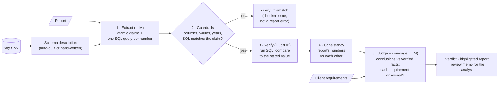

# 🔎 Report Checker

[](https://github.com/eytanberko/report-checker/actions/workflows/ci.yml)

**An AI reviewer that checks an analyst's report against the data, and against what the client asked, before it ships.**

**Showcase: [eytanberko.github.io/report-checker](https://eytanberko.github.io/report-checker/)** (the reports, ticked, with the evidence and SQL behind every flag) · **App: [report-checkerwitz.streamlit.app](https://report-checkerwitz.streamlit.app/)** (saved runs; live checks are off in the public demo)

## Why I built this
I lead a team of data analysts, and I review every product before it ships: are the numbers right,
do the conclusions follow from the data, does it answer what the client asked?
This is slow, manual, and it doesn't scale. Report Checker automates the parts that can be
automated, and shows its work for everything else.

**Design principle:** the LLM never decides whether a number is correct. It only translates text
into SQL; the database decides. Every verdict shows the SQL behind it, so a human can audit it.

## How it works


| Stage | How | Output |
|---|---|---|
| Extract | LLM splits the report into atomic claims and writes one DuckDB query per numeric claim | claims + SQL |
| Guardrails | Python, before execution: columns exist, values (e.g. countries) exist, years in range, the query's country/year are named or implied by the claim's sentence | 🔧 `query_mismatch` |
| Verify | DuckDB runs the query; the stated value must match within rounding | ✅ `verified` / ❌ `contradicted` |
| Consistency | Python, **no data access**: a stated change vs its stated endpoints under the claim's own wording (%, percentage points, per year compounded), shares above 100%, the same metric stated twice | 🟧 `inconsistent` |
| Judge | LLM checks conclusions against the verified facts and a data table built in Python (every column for the countries/years the report mentions) | ✅ `supported` / ⚠️ `unsupported` |
| Coverage | LLM checks each client requirement; a wrong scope (period, comparison group, metric) is `partial` | ✅ / ⚠️ / ❌ |

**One model that can finish (v1.1).** Every LLM step runs on `gemini-3.5-flash-lite` (`GEMINI_MODEL` for
extraction, `JUDGE_MODEL` for the judge; both default to it).
- **v1.0** used a stronger judge (`gemini-3.6-flash`), because flash-lite had missed two reasoning cases on the
  benchmark. Its free tier allows about 20 calls a day, and server overloads used up those calls with retries.
  The benchmark never finished: 6 of 10 reports were scored. That partial result stays in the run history.
- **v1.1** uses the fast model for every step. Its free tier (about 500 calls a day) can finish the benchmark,
  the held-out test and repeat runs. The prompts are the same as v1.0's (`38701a08`).

Extraction is mechanical and checked downstream: every query goes through guardrails and the database. The
judge's work is not checked downstream, so the judge setup was chosen on the benchmark (see "Frozen
configuration: v1.1"). Both models and the number of judge votes are recorded with every result, in
`metrics.md` and in `history.csv`.

Anything the checker can't use (malformed LLM output, a claim without a number) becomes ❔ `unverifiable`
with the reason, never a crash. Data verdicts take precedence: a number the data contradicts stays
"contradicted", and an internal inconsistency it explains is added to its note.

## What it catches
The benchmark's error taxonomy, built from the mistakes I see most in real analyst work:

| Error type | Example |
|---|---|
| wrong_number | coal at "13.4%" (data: 3.4%) |
| wrong_period | correct metric, value from the previous year |
| wrong_entity | Greece's number attributed to Cyprus |
| wrong_calculation | "+15%" where it is +15 percentage points |
| plausible_calculation | looks right, wrong method: "2.8% per year" as 28%/10 (compound: 2.5%); "+891%" as a ratio (change: +791%) |
| unsupported_conclusion | "coal phase-out was driven by solar" (it was gas) |
| missing_requirement | the client asked for a peer comparison; there is none |
| misread_requirement | answers a different question: change since 2020 when the client asked since 2015; Germany as a "Mediterranean peer" |

## Benchmark
10 reports answering the same client request (`benchmark/`): 3 clean, 7 with **16 planted errors**.
Results: [`results/metrics.md`](results/metrics.md) (recall, precision, false alarms, by error type) and
[`results/history.csv`](results/history.csv) (one row per run: model, prompt version, metrics, API calls).

### Benchmark notes: what changed after the first run, and why
The first run (then 8 reports; 7 scored before the free-tier quota ran out) caught all 12 planted errors in
those reports, with 4 flags counted as false alarms. Reviewing each one led to these changes:
- **Cascade errors.** 3 of the 4 "false alarms" were correct flags caused by a planted error, e.g. the
  conclusion "the phase-out is far from complete" built on a wrong coal figure. Planted errors can now list
  them under `also` (quote substrings) or `also_requirements` (requirement ids). Matching flags are reported
  as "cascade errors caught": not false alarms, and not extra recall.
- **Judge prompt adjusted once.** The 4th false alarm was the judge rejecting a data-grounded risk statement
  (made worse by the extractor splitting off the fragment "The main risk").
  A risk or recommendation grounded in numbers from the data now counts as supported; "unsupported" is
  reserved for claims contradicted by the data or relying on facts not in it. *Because this change was made
  after seeing results, the benchmark is no longer a fully blind test of the judge.*
- **Two error types and two reports added** (`misread_requirement`, `plausible_calculation`), with matching
  prompt rules: a wrong-scope answer is "partial", and "X% per year on average" means compound growth.
- **Deterministic stages added** (guardrails, internal consistency). They change no LLM prompt; saved
  results are re-checked with them for free.

After the first full 10-report run on one model (`gemini-3.5-flash-lite`: recall 15/16, 7 false alarms),
two scoring rules and one judge change were added. *All three were added after seeing that run's results.*
- **One planted error, many flags:** if several flagged claims contain the same planted error's match, the
  error counts once and the extra flags are not false alarms (report_07's "13.1%" appeared in a numeric
  claim and in a judgment claim that bundled it).
- **Requirement-level cascades, as a general rule:** a requirement marked partial/missing is a cascade of a
  planted claim error, not a false alarm, when its evidence quote contains that error's match, or overlaps
  (in the report text) a claim the checker flagged. 6 of the 7 false alarms were the coverage judge marking
  an answered requirement "partial" *because its number was wrong*; that error is already caught by the SQL
  check, so counting it again would double-penalise one mistake. This replaces per-report labels for
  requirements; quote-level `also` labels remain.
- **Judge data context:** the judge missed "the coal phase-out was driven mainly by solar" because it only
  saw the report's own numbers, and the report never mentions gas. It now also gets a table built in Python,
  with no extra LLM call: for every country and year in the extracted claims, all `*_share_elec` columns and
  `electricity_generation`, plus the absolute change from the first to the last year (gas +28.0 points,
  solar +14.4).

The re-run with the data context (recall 14/16, 1 false alarm) led to the last changes before the freeze,
*also made after seeing results*:
- **Query mismatches shown to the judge as "not checked (checker query failed)".** The judge had read the
  status `query_mismatch` as a problem in the report and marked a requirement partial (report_10 R4). A failed
  checker query is never a report problem. (Mismatched queries are also no longer used by the consistency
  checks, since their SQL doesn't measure what the claim says.)
- **Judge moved to `gemini-3.6-flash`.** Both remaining misses were judge reasoning errors on flash-lite: it
  cited solar +14.4 / coal -42.0 but ignored gas +28.0, and it noted "2020 instead of 2015" yet marked the
  requirement covered.

### v1.0: a stronger judge that couldn't finish (history)
`v1.0-frozen` used the same prompts (`38701a08`) with `gemini-3.6-flash` as the judge. Its free tier allows
about 20 calls a day, and server overloads used them up on retries. It scored reports 01-06 only: 10/10
planted errors caught, 0 false alarms. Reports 07-10 never ran. That partial result stays in
`results/history.csv` and in the site's run history.

### Choosing the judge for v1.1 (decided before the run)
v1.1 runs every step on `gemini-3.5-flash-lite`, which the free tier can finish. Two judge setups were run on
the full benchmark, with a rule written down beforehand: *a majority vote of 3 replaces a single call only if
its F1 is higher; a tie keeps the single call, the cheaper setup.*

| Judge setup | Recall | Precision | False alarms | Results |
|---|---|---|---|---|
| (a) one call | 14/16 (88%) | 100% | 0 | `results/compare/single/` |
| (b) majority of 3 votes | 14/16 (88%) | 100% | 0 | `results/compare/vote3/` |

Both missed the same two errors, so the tie keeps (a).

### Frozen configuration: `v1.1-frozen`
| | |
|---|---|
| Prompt version | `38701a08` (hash of both prompt templates and the judge's fact wording; same as v1.0) |
| Extraction model | `gemini-3.5-flash-lite` |
| Judge model | `gemini-3.5-flash-lite`, one call per report (`JUDGE_VOTES=1`) |
| Frozen on | 2026-11-06 |

**Benchmark result (10 reports, 16 planted errors):** recall 14/16 (88%), precision 100%, 0 false alarms
([`results/metrics.md`](results/metrics.md)). The two misses are the judge reasoning cases that v1.0's
stronger judge was brought in for:
- **report_06, "driven mainly by the growth of solar":** an unsupported cause. Gas rose more than solar. The
  judge noted gas "also expanded" yet called solar a key driver and marked the claim supported.
- **report_09, R1:** the report measured change since 2020 when the client asked for change since 2015. The
  judge's own reason says "2020 as the starting point rather than 2015", yet it marked the requirement covered.

The same two weaknesses are why v1.0 used a stronger judge. v1.1 trades them for a configuration that can
finish on the free tier.

From this tag on there are no prompt, scoring-rule or model changes. Everything above was tuned on this
benchmark, so only the held-out set can show how well it generalises.

### Held-out test (run once, after the freeze)
`benchmark/holdout.yaml`: 4 reports (1 clean, 3 with 7 planted errors) that were never used for tuning. Run
once with `v1.1-frozen` on 2026-11-06 (8 API calls, no retries), published as it came, with no changes
afterwards ([`results/heldout/metrics.md`](results/heldout/metrics.md)):

- **Recall 6/7 (86%), precision 100%, 0 false alarms.** 2 cascade flags (holdout_03: R3 and R4 marked partial
  because their figures were wrong).
- **The miss: holdout_02, "Israel's renewables share reached 16.8% in 2025"** (data: 16.93%). Not bad SQL
  and not a missed extraction: the claim was extracted on its own (C1) with the right query
  (`renewables_share_elec`, Israel, 2025). It passed the number tolerance, which allows the larger of the
  report's rounding (0.05 for one decimal) and 1% of the data value (0.17 here). The gap is 0.13, so it was
  marked verified. For percentages the 1% allowance is too loose. It stays as measured; any fix belongs to a
  later version, scored on new held-out data.

> **Found after the run: an error the answer key missed.** holdout_04 uses Jordan as a Mediterranean peer
> (Jordan has no Mediterranean coast). This real error was missing from the GPT-written answer key and the
> checker did not flag it either. Counting it, the checker caught 6 of 8 real errors.
>
> | Counted against | Caught |
> |---|---|
> | The answer key (unchanged) | **6 of 7** planted mistakes (86%) |
> | All real errors, including Jordan | **6 of 8** (75%) |
- With 4 reports, one mistake more or less moves the result a lot.


### Repeat runs: how much the results vary
The frozen v1.1 settings, run 3 more times on the benchmark with the cache bypassed (`--salt repeat-1/2/3`,
`results/repeats/`), so extraction and judge answer afresh each time (62 API calls in all).

| Run | Recall | Precision | False alarms |
|---|---|---|---|
| Frozen run | 14/16 (88%) | 100% | 0 |
| Repeat 1 | 14/16 (88%) | 93% | 1 |
| Repeat 2 | 14/16 (88%) | 100% | 0 |
| Repeat 3 | 14/16 (88%) | 93% | 1 |

**Across the 3 repeats: recall 88% in every run; precision 93% to 100%; 0 to 1 false alarms.**
- Recall did not move: every run caught the same 14 and missed the same two judge cases (report_06 solar,
  report_09 R1).
- Both false alarms came from extraction writing a wrong SQL formula for a correct "+28% generation" claim:
  a missing pair of parentheses (repeat 1, report_05: computed 8209 instead of 27.8) and a misplaced one
  (repeat 3, report_01: the year filter swallowed the subtraction, so no row matched). The frozen run wrote
  both queries correctly. Guardrails check countries, years and columns, not formulas; this is the known
  limitation below, now measured: 2 wrong formulas in about 280 numeric claims over the 3 repeats.

Infrastructure changes after the v1.0 freeze (no effect on prompts, rules or scores):
- **Overload retries:** on 500/503 the client waits 2, 4, then 8 minutes, at most 3 retries per report, then
  stops cleanly. Cached answers never count. A later run resumes from the cache.

Each run records the prompt version (a hash of both prompt templates); `legacy` marks results made with the
first-run prompts. Scores for different prompt versions are not directly comparable.

## Run it
```bash
pip install -r requirements-dev.txt    # app + tests + lint (the app alone: requirements.txt)
python -m pytest -q                    # offline tests, no API key needed
ruff check . && mypy                   # lint + type check (CI runs all three on every push)
streamlit run app.py                   # demo UI: saved runs work offline; "Run live check" calls the API
                                       # (hidden when no API key is set, e.g. in the public demo)

# CLI: prints the verdict, writes <report>.review.md; exit 0 = clean, 1 = issues, 2 = could not run
python -m checker check --report r.md --requirements req.md --data data.csv [--offline]

# Benchmark: resumable (reports finished with the current prompts are reused), throttled,
# stops cleanly when the daily free-tier quota runs out; re-run to resume.
set GEMINI_API_KEY=your_key            # Windows (mac/linux: export ...). Free key: aistudio.google.com
python evaluate.py
python evaluate.py --offline           # score saved results only, no API calls
```
- **LLM provider:** Gemini by default: extraction on `GEMINI_MODEL` (default `gemini-3.5-flash-lite`), judge on
  `JUDGE_MODEL` (default also `gemini-3.5-flash-lite`), judge votes `JUDGE_VOTES` (default 1); see "One
  model that can finish". Check your free-tier limits at
  aistudio.google.com/rate-limit. Groq is optional:
  `LLM_PROVIDER=groq`, `GROQ_API_KEY` (free key at console.groq.com), `GROQ_MODEL`.
- **Cache:** LLM answers are cached in `.llm_cache/` (committed), so re-runs are free and reproducible.
  `LLM_OFFLINE=1` never calls an API.
- **Your own data:** `--data any.csv`. The schema description for the LLM (columns, types, ranges, example
  values, categories) is built from the file. `examples/cafes/` is a tiny synthetic example.

### Check your own report
The public site and the public demo have no API key, so they only show saved runs. To check your own data, run
the app on your machine with a free Gemini key (aistudio.google.com):
```bash
git clone https://github.com/eytanberko/report-checker && cd report-checker
pip install -r requirements.txt
set GEMINI_API_KEY=your_key            # Windows (mac/linux: export GEMINI_API_KEY=your_key)
streamlit run app.py
```
Open the **Try your own** tab, upload a CSV, paste the report and the client's requirements, and press **Run
check**. The description of the data that the model sees (columns, types, ranges, categories) is built from the
file; open "Schema built from ..." to see it. The result is the same as for the benchmark: the highlighted
report, the claim details with their SQL, requirement coverage and a review memo to download. The toggle "Fill in
the café example" loads `examples/cafes/` (invented numbers; the check flags the wrong growth and revenue
figures). A CSV that cannot be used (empty, no data rows, no numeric columns, not a CSV) gets a plain error, as do
a used-up daily quota and an overloaded server (two short retries, then a message). One check is 2 API calls.
The same check from the command line: `python -m checker check --report r.md --requirements req.md --data
data.csv`.

### Showcase site (GitHub Pages, `/docs`)
A static site (plain HTML/CSS/JS, no build step) generated from the saved results. After every benchmark run:
```bash
python scripts/build_site.py           # rewrites docs/data/site.js from results/ and benchmark/ (no API calls)
```
then commit and push; GitHub Pages serves `/docs` from `main`. A held-out result appears on the site once
`results/heldout/metrics.json` exists. Design context: `PRODUCT.md`, `DESIGN.md`.

### Public demo (Streamlit Community Cloud)
The app runs without any API key: it shows the saved benchmark runs (highlighting, memo, metrics) and hides
live checks. Deploy from this repo with `app.py` as the main file; `requirements.txt` holds only what the app
needs. To enable live checks in a private deployment, add `GEMINI_API_KEY` under the app's Secrets.

## Project layout
| Path | What |
|---|---|
| `checker/core.py` | the pipeline; `recheck()` re-runs the deterministic stages on a saved result |
| `checker/verify.py`, `guardrails.py`, `consistency.py` | the deterministic checks (no LLM) |
| `checker/llm.py`, `prompts.py`, `normalize.py` | LLM client (cache, throttle, quota), prompts, defensive parsing |
| `checker/dataset.py`, `schema.py` | pluggable CSV data; hand-written energy description |
| `checker/highlight.py`, `memo.py`, `cli.py` | inline highlighting, review memo, command line |
| `app.py`, `evaluate.py` | Streamlit demo, benchmark runner |
| `benchmark/` | the 10 reports, answer key and client request |

## Data
Our World in Data, energy dataset (electricity mix by country, 2010-2025), trimmed to 17 countries.

## Limitations & next steps
- **Small benchmark:** 10 reports, one client request, one dataset. The reports were written for this project. The mistake types come from errors I see when reviewing analysts' work.
  The judge prompt was tuned once after seeing results. Next: real (anonymised) reports labelled by a
  second reviewer.
- **The LLM can still write a wrong query.** Guardrails catch the wrong country, year, column or value,
  but not a wrong formula. Next: generate each query twice and flag disagreement.
- **Claim splitting is an LLM step.** A fragment like "The main risk" can be judged on its own. Next: a
  deterministic check that every quote is a full clause.
- **Consistency checks parse simple SQL** (one column, one entity, one or two years). Comparisons and
  complex queries are skipped, not guessed.
- **Judging conclusions is an LLM opinion**, not a proof; it is labelled as a warning, not an error.
