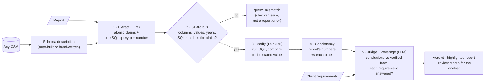

# 🔎 Report Checker

**An AI reviewer that checks an analyst's report against the data, and against what the client asked, before it ships.**

## Why I built this
I lead a team of data analysts, and I review every product before it ships: are the numbers right,
do the conclusions follow from the data, does it answer what the client asked?
This is slow, manual, and it doesn't scale. Report Checker automates the parts that can be
automated, and shows its work for everything else.

**Design principle:** the LLM never decides whether a number is correct. It only translates text
into SQL; the database decides. Every verdict shows the SQL behind it, so a human can audit it.

## How it works


| Stage | How | Output |
|---|---|---|
| Extract | LLM splits the report into atomic claims and writes one DuckDB query per numeric claim | claims + SQL |
| Guardrails | Python, before execution: columns exist, values (e.g. countries) exist, years in range, the query's country/year are named or implied by the claim's sentence | 🔧 `query_mismatch` |
| Verify | DuckDB runs the query; the stated value must match within rounding | ✅ `verified` / ❌ `contradicted` |
| Consistency | Python, **no data access**: a stated change vs its stated endpoints under the claim's own wording (%, percentage points, per year compounded), shares above 100%, the same metric stated twice | 🟧 `inconsistent` |
| Judge | LLM checks conclusions against the verified facts | ✅ `supported` / ⚠️ `unsupported` |
| Coverage | LLM checks each client requirement; a wrong scope (period, comparison group, metric) is `partial` | ✅ / ⚠️ / ❌ |

Anything the checker can't use (malformed LLM output, a claim without a number) becomes ❔ `unverifiable`
with the reason, never a crash. Data verdicts take precedence: a number the data contradicts stays
"contradicted", and an internal inconsistency it explains is added to its note.

## What it catches
The benchmark's error taxonomy, built from the mistakes I see most in real analyst work:

| Error type | Example |
|---|---|
| wrong_number | coal at "13.4%" (data: 3.4%) |
| wrong_period | correct metric, value from the previous year |
| wrong_entity | Greece's number attributed to Cyprus |
| wrong_calculation | "+15%" where it is +15 percentage points |
| plausible_calculation | looks right, wrong method: "2.8% per year" as 28%/10 (compound: 2.5%); "+891%" as a ratio (change: +791%) |
| unsupported_conclusion | "coal phase-out was driven by solar" (it was gas) |
| missing_requirement | the client asked for a peer comparison; there is none |
| misread_requirement | answers a different question: change since 2020 when the client asked since 2015; Germany as a "Mediterranean peer" |

## Benchmark
10 reports answering the same client request (`benchmark/`): 3 clean, 7 with **16 planted errors**.
Results: [`results/metrics.md`](results/metrics.md) (recall, precision, false alarms, by error type) and
[`results/history.csv`](results/history.csv) (one row per run: model, prompt version, metrics, API calls).

### Benchmark notes: what changed after the first run, and why
The first run (then 8 reports; 7 scored before the free-tier quota ran out) caught all 12 planted errors in
those reports, with 4 flags counted as false alarms. Reviewing each one led to these changes:
- **Cascade errors.** 3 of the 4 "false alarms" were correct flags caused by a planted error, e.g. the
  conclusion "the phase-out is far from complete" built on a wrong coal figure. Planted errors can now list
  them under `also` (quote substrings) or `also_requirements` (requirement ids). Matching flags are reported
  as "cascade errors caught": not false alarms, and not extra recall.
- **Judge prompt adjusted once.** The 4th false alarm was the judge rejecting a data-grounded risk statement
  (made worse by the extractor splitting off the fragment "The main risk").
  A risk or recommendation grounded in numbers from the data now counts as supported; "unsupported" is
  reserved for claims contradicted by the data or relying on facts not in it. *Because this change was made
  after seeing results, the benchmark is no longer a fully blind test of the judge.*
- **Two error types and two reports added** (`misread_requirement`, `plausible_calculation`), with matching
  prompt rules: a wrong-scope answer is "partial", and "X% per year on average" means compound growth.
- **Deterministic stages added** (guardrails, internal consistency). They change no LLM prompt; saved
  results are re-checked with them for free.

Each run records the prompt version (a hash of both prompt templates); `legacy` marks results made with the
first-run prompts. Scores for different prompt versions are not directly comparable.

## Run it
```bash
pip install -r requirements.txt
python -m pytest -q                    # offline tests, no API key needed
streamlit run app.py                   # demo UI: saved runs work offline; "Run live check" calls the API

# CLI: prints the verdict, writes <report>.review.md; exit 0 = clean, 1 = issues, 2 = could not run
python -m checker check --report r.md --requirements req.md --data data.csv [--offline]

# Benchmark: resumable (reports finished with the current prompts are reused), throttled,
# stops cleanly when the daily free-tier quota runs out; re-run to resume.
set GEMINI_API_KEY=your_key            # Windows (mac/linux: export ...). Free key: aistudio.google.com
python evaluate.py
python evaluate.py --offline           # score saved results only, no API calls
```
- **LLM provider:** Gemini by default (`GEMINI_MODEL`, default `gemini-3.5-flash-lite`: the free tier allows
  far more requests per day than the full flash models, about 500 vs 20, so the whole benchmark runs in one day
  on one model; check your limits at aistudio.google.com/rate-limit). Groq is optional:
  `LLM_PROVIDER=groq`, `GROQ_API_KEY` (free key at console.groq.com), `GROQ_MODEL`.
- **Cache:** LLM answers are cached in `.llm_cache/` (committed), so re-runs are free and reproducible.
  `LLM_OFFLINE=1` never calls an API.
- **Your own data:** `--data any.csv`. The schema description for the LLM (columns, types, ranges, example
  values, categories) is built from the file. `examples/cafes/` is a tiny synthetic example.

## Project layout
| Path | What |
|---|---|
| `checker/core.py` | the pipeline; `recheck()` re-runs the deterministic stages on a saved result |
| `checker/verify.py`, `guardrails.py`, `consistency.py` | the deterministic checks (no LLM) |
| `checker/llm.py`, `prompts.py`, `normalize.py` | LLM client (cache, throttle, quota), prompts, defensive parsing |
| `checker/dataset.py`, `schema.py` | pluggable CSV data; hand-written energy description |
| `checker/highlight.py`, `memo.py`, `cli.py` | inline highlighting, review memo, command line |
| `app.py`, `evaluate.py` | Streamlit demo, benchmark runner |
| `benchmark/` | the 10 reports, answer key and client request |

## Data
Our World in Data, energy dataset (electricity mix by country, 2010-2025), trimmed to 17 countries.

## Limitations & next steps
- **Small, self-written benchmark:** 10 reports, one client request, one dataset, errors planted by me.
  The judge prompt was tuned once after seeing results. Next: real (anonymised) reports labelled by a
  second reviewer.
- **The LLM can still write a wrong query.** Guardrails catch the wrong country, year, column or value,
  but not a wrong formula. Next: generate each query twice and flag disagreement.
- **Claim splitting is an LLM step.** A fragment like "The main risk" can be judged on its own. Next: a
  deterministic check that every quote is a full clause.
- **Consistency checks parse simple SQL** (one column, one entity, one or two years). Comparisons and
  complex queries are skipped, not guessed.
- **Judging conclusions is an LLM opinion**, not a proof; it is labelled as a warning, not an error.
